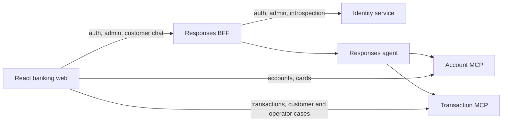

# Repository Guide

This repository is a banking-assistant prototype built with Python, Microsoft Agent Framework, Foundry Responses, FastMCP, React, and Terraform.

This file owns repository-wide agent instructions. Local Copilot notes supplement
these rules without replacing them or duplicating task ledgers.
Use [ARCHITECTURE.md](ARCHITECTURE.md) for the code map and
[docs/adr/README.md](docs/adr/README.md) for decision rationale.

## Active Architecture



- [app/agent](app/agent): Account/Transaction handoff workflow and Responses host.
- [app/business-api/identity](app/business-api/identity): credentials, profiles,
  identity lifecycle, JWT issuance and administrator operations.
- [app/responses-bff](app/responses-bff): database-free browser boundary for Identity
  facades and customer Responses chat.
- [app/business-api/account](app/business-api/account): account/card REST reads and
  Account MCP tools.
- [app/business-api/transaction](app/business-api/transaction): transaction REST/MCP
  reads, customer disputes and operator queue, claim and adjudication APIs.
- [app/business-api/shared/src/banking_shared](app/business-api/shared/src/banking_shared):
  canonical SQLModel persistence tables and database wiring.
- [app/business-api/data](app/business-api/data): Alembic migrations, historical
  archives and CSV-to-PostgreSQL pipeline.
- [app/frontend/banking-web](app/frontend/banking-web): React/Vite UI for customer
  banking, support cases, administrator pages and operator queue/detail pages.
  `/operator` redirects to `/operator/support-cases`.
- [infra](infra): Terraform for the App Service stack and Foundry resources.
- [app/agent/azure.yaml](app/agent/azure.yaml): separate azd root for the hosted agent.

This is an implementation map, not evidence of deployed or live-data acceptance.

## Python Package Convention

Python projects install their application packages from `src/` through their own
`pyproject.toml` and uv environment. Keep meaningful responsibility-based subpackages
such as `models`, `routers`, `services`, `auth`, `projections`, and domain helpers;
do not flatten them into `src/<package>` or create generic catch-all modules.
The Agent follows the same convention under `app/agent/src/app`.

Use package-qualified imports and stable module/console entrypoints. Do not repair
imports with runtime `sys.path` changes or `PYTHONPATH`. Checkout scripts may remain
thin CLI adapters, with implementation inside the installed package. See the
[package map](ARCHITECTURE.md) and [service structure](app/business-api/README.md#-service-structure)
for current namespaces and responsibilities.

## Local Development

The root `.vscode` configuration owns local orchestration. The default task
`prepare full stack dev` (F5 through `DEV - Full Stack Ordered`, or Ctrl+Shift+B) starts:

| Port   | Process                    |
| ------ | -------------------------- |
| `5170` | Banking web (HTTPS)        |
| `8080` | Responses BFF              |
| `8088` | Local Responses agent      |
| `8070` | Account MCP                |
| `8071` | Transaction MCP            |
| `8091` | Identity and OAuth (HTTPS) |

The task starts all six services, with one Identity HTTPS process, in separate terminals through
root [tasks.json](.vscode/tasks.json), without debugging or automatic browser launch.
The root local-output adapter appends ANSI-free UTF-8 daily logs inside each backend
project's ignored `logs/` directory and colors severity labels on the console.
The frontend runs npm directly, without the Python adapter or file logging.
Local agent tasks set `ENABLE_SENSITIVE_DATA=true` and
`OTEL_INSTRUMENTATION_GENAI_CAPTURE_MESSAGE_CONTENT=true` for owner-requested debugging.
Keep logs private: common credential redaction is not a general sensitive-content filter.
This is local task behavior, not a change to hosted logging or telemetry.
Each service has its own `.env` and `.env.example`. See the component guides below
for configuration and the operational rules below for execution restrictions.

## Task Guides

| Task                                       | Source of truth                                                                               |
| ------------------------------------------ | --------------------------------------------------------------------------------------------- |
| Architecture and security constraints      | [Locked architecture](#locked-architecture-do-not-relitigate-without-new-evidence)            |
| Data ingestion and manifest verification   | [Data module guide](app/business-api/data/README.md)                                          |
| Replay and held-out evaluation             | [Evaluation guide](evals/README.md)                                                           |
| Evaluation policy and verified CI evidence | [Evaluation requirements](#evaluation-requirements)                                           |
| Identity, bootstrap and administrator APIs | [Identity guide](app/business-api/identity/README.md)                                         |
| BFF identity facades and Responses proxy   | [BFF guide](app/responses-bff/README.md)                                                      |
| Frontend chat recovery and case evidence   | [Frontend recovery guide](app/frontend/banking-web/README.md#chat-recovery-and-case-evidence) |
| Infrastructure                             | [Infrastructure guide](infra/README.md)                                                       |

## Focused Checks

Run from repository root; select the commands for the changed component. These are
local checks, not a replacement for the full CI workflow.

```powershell
$env:OTEL_SDK_DISABLED = "true"
rtk proxy uv run --directory app\agent python -m pytest tests -q
rtk proxy uv run --directory app\responses-bff python -m pytest tests -q
rtk proxy uv run --directory app\business-api\identity python -m pytest tests -q
rtk proxy uv run --directory app\business-api\account python -m pytest tests -q
rtk proxy uv run --directory app\business-api\transaction python -m pytest tests -q
rtk proxy uv run --directory app\business-api\data python -m pytest tests -q
rtk proxy uv run --project evals --extra offline python -m pytest evals\tests -q

rtk proxy npm --prefix app\frontend\banking-web run test
rtk proxy npm --prefix app\frontend\banking-web run lint
rtk proxy npm --prefix app\frontend\banking-web run build

rtk proxy terraform -chdir=infra fmt -check -recursive
rtk proxy terraform -chdir=infra validate
```

For ingestion-only edits, narrow the data test selector to
`tests\test_run_pipeline.py`; it is not the full data suite. Terraform validation
requires an initialized working directory; see the infrastructure guide.

CI-specific commands and prerequisites live in:

- [Python CI action](.github/actions/ci-python/action.yml): frozen dependency sync,
  syntax compilation, pytest and deployment-requirements verification.
- [Node CI action](.github/actions/ci-node/action.yml): clean dependency installation,
  lint, Vitest coverage and build. The frontend currently has no `typecheck` script.
- [Hosted Agent CI](.github/workflows/ci-hosted-agent.yml) and the
  [offline comparator guide](evals/README.md#offline-comparator-and-scoring): offline
  evaluation tests, fresh deterministic baseline and rescoring. Real-model replay
  is a separate opt-in check, not part of the default commands above.

## Instruction ownership

This file is the single source of repository-wide engineering rules: architecture,
security, service boundaries, coding/localization contracts, validation commands and
execution authorization. [Copilot instructions](.github/copilot-instructions.md) add
only Copilot response tone, language and presentation preferences; they must not
repeat or override those engineering rules.

Task procedures belong in skills and component guides. GitHub owns backlog and
acceptance; dated local handoffs hold recorded checks, environment observations and
session continuation work. Do not add test counts, commit inventories or temporary
OAuth queues to always-on instructions. Existing historical evidence below retains
its explicit limits; current source, tests and accepted ADRs outrank historical notes
and repository memory.

The hackathon has concluded. Ignored `plan/` material is archival, not an active queue.
Do not stage/publish it or remove its ignore rule. GitHub owns backlog status and
acceptance; follow issue #24 and its linked work rather than duplicating a local queue.
The repository extends Microsoft's public banking-assistant sample. Use the architecture
map and accepted ADRs for current decisions.

## Locked architecture (do not relitigate without new evidence)

- One workflow only: Account and Transaction inquiries, implemented under
  `app/agent/src/app/agents/azure_chat/` as a `HandoffBuilder` workflow served through
  Foundry Responses, with one persisted support-case layer on top: transaction
  disputes. The dispute case is a tracking/workflow layer over the existing Account
  and Transaction MCP tools, not a new specialist agent. Keep generic MCP approval
  handling, but do not reintroduce Payment, uploads, ChatKit, card support, or credit
  eligibility, and do not add a second conversational specialist.
- Data store: Azure Database for PostgreSQL Flexible Server, accessed through SQLModel
  (SQLAlchemy 2.0 + Pydantic), never raw SQL strings, never Fabric/Synapse for the live
  tool-calling path.
- Auth: custom email/password with JWT, not Microsoft Entra ID. The dedicated
  `app/business-api/identity` service owns persisted Argon2 credentials, profiles, fixed
  customer/operator/admin roles, lifecycle status, audit and short-lived HS256 JWT
  issuance. The DB-free Responses BFF exposes only allowlisted identity/admin
  facades and fronts the customer-only Responses agent. Preserve customer claims
  `sub`, `customer_id`, `email`, `locale`, `iss`, `aud`, `exp`; additionally require
  `role` and `identity_version`. Staff tokens omit `customer_id`; never fabricate a
  Customer for staff. Only active principals with the current version authenticate.
  BFF and direct Account/Transaction REST boundaries check Identity on every protected
  request, without caching; Auth unavailability fails closed. Internal introspection
  uses a separate `AUTH_INTERNAL_SECRET`, never the agent-only bearer.
  Account/Transaction REST application JWTs remain completely independent from
  `internal_identity.py`'s short-lived HMAC bearer minted fresh per MCP call.
  Preserve service-layer ownership. No second login, public registration, arbitrary
  role assignment, fixed token or mock session token. Admin bootstrap uses an
  explicit seed service with externally supplied credentials, never startup seeding.
  Real reviewer queues/verdicts and live migration/provisioning remain separately
  gated; identity implementation does not enable them. See ADR 0006.
- Authorization: every business-api service method that reads or acts on an
  `accountId`, `productId`, or similar identifier must verify it belongs to the
  verified `customer_id` before returning data. Account and Transaction already enforce
  this through PostgreSQL product relationships and transaction filters. Preserve and
  revalidate the checks in the installed `services/` subpackages when changing repositories; agent prompt wording is not an
  authorization boundary.
- Language split: tool `name`/`description` in `mcp_tools.py` and agent
  `instructions` stay in English, always. Only the final response language is dynamic,
  driven by the authenticated user's stored `locale` claim, injected once per request
  through the context provider, not by the language of the current message. That
  shared per-request directive (`app/agent/src/app/context/user_profile_provider.py`) requires translating
  every piece of user-facing text into that language: prose, any table/list labels
  the agent generates, and human-readable status or category words a tool returns
  (for example active, approved, declined). The only carve-out is a machine-readable
  code identified by containing `_` or `-` (for example the support-case status
  `WAITING_USER_APPROVAL`), which exists purely for frontend i18n key matching and
  must never be translated or reworded in structured transport. Preserve canonical
  structured values while localizing human labels in generated prose; the frontend
  never translates complete agent Markdown. The directive and deterministic
  regressions are implemented, not proof of live-model locale compliance. Spanish
  generated/display wording uses `reclamo`/`reclamos` with masculine grammar;
  preserve quoted customer reasons and original audit text verbatim.

## Azure Developer CLI project roots

- This repo uses two separate `azd` project roots and manifests:
  - Root `./azure.yaml`: App Service stack for `identity`, `account`, `transaction`,
    Responses BFF and `web` (`infra.provider: terraform`, backed by `infra/`). The agent is not part of this stack.
  - `./app/agent/azure.yaml`: hosted Foundry agent stack.
- For agent stack operations from repository root, use `--cwd app/agent` (for example,
  `azd up --cwd app/agent`, `azd deploy --cwd app/agent`, `azd env set ... --cwd app/agent`).
- Do not rely on `AZD_CONFIG_FILE` as the manifest-selection mechanism in this repository.
- Root App Service naming rule: keep the frontend web app as `app-banking-web-<env>`
  (for example, `app-banking-web-development`) to avoid ambiguity with account/transaction apps.

## Hosted-agent packaging and startup

- Preserve the installed `src/app` package and root `app/agent/main.py` entrypoint.
  The agent manifest uses Python 3.13 and `dependencyResolution: remote_build`.
  Its generated `requirements.txt` must retain `.` to install the application
  noneditably; do not use `--no-emit-project`, flatten packages, or add `PYTHONPATH`
  or runtime `sys.path` repairs. Regenerate with the frozen export documented in
  [the agent guide](app/agent/README.md#hosted-source-dependency-installation).
  Preserve the per-request `ResponsesHostServer(create_agent)` factory, async telemetry
  flush and 100-item history boundary, separate from checkpoints/snapshots.
- A source ZIP need not contain site-packages. Check remote import paths and the
  actual startup exception before attributing HTTP 424 / `session_not_ready` to
  packaging. CI's isolated noneditable installation and CD's export check preserve
  the artifact contract, not proof of readiness after every deployment.
- Hosted `FOUNDRY_PROJECT_ENDPOINT` and `INTERNAL_IDENTITY_SECRET` are explicitly
  mapped from the selected agent azd environment. Local dotenv templates are not
  hosted configuration and must remain excluded from the ZIP. Empty signer
  substitution fails `Settings` validation at startup; the signer must be nonblank,
  at least 32 characters, and match the BFF's existing internal identity secret.
  `AUTH_INTERNAL_SECRET` remains separate. Do not rotate or weaken validation as
  a startup workaround. Authorized synchronization captures the existing Key Vault
  value in process memory and verifies exact azd readback without printing secrets,
  dumping environment JSON, or writing plaintext temporary files.
- Startup recovery alone does not establish hosted identity, authorization, locale,
  data or evaluation acceptance. Keep historical recovery evidence in task handoffs,
  not in these permanent instructions.

## OAuth and Toolbox boundaries

- Banking email/password login and application JWTs remain independent from MCP
  OAuth. Local OAuth uses `AGENT_RUNTIME=local` and `MCP_IDENTITY_MODE=oauth` with
  direct Account/Transaction MCP, even though inference uses Foundry models.
  HMAC remains the default compatibility mode, never an invalid-OAuth fallback.
- Require exact `mcp.access` for existing customer reads and dispute operations.
  Reject old `banking.read` and staff grants. Never silently expand stored scope;
  ownership, explicit dispute consent and assigned-operator authority remain separate.
- Identity owns confidential clients, grants and schema `oauth`. Preserve exact HTTPS
  callbacks, S256 PKCE, explicit Allow/Deny, active/current customer checks at issuance,
  hashed credentials and single-use codes. Keep private signing keys at Identity and
  client secrets server-side. Internal introspection uses `AUTH_INTERNAL_SECRET`.
- MCP verifies RS256 with trusted public JWKS, issuer/audience, customer claims and
  at most 3600-second access-token TTL; authorization codes/state retain 300 seconds.
  Revocation/profile changes can lag until access-token expiry; ADR 0012 remains Proposed. BFF and protected REST current-Identity checks remain uncached.
- BFF owns session-bound state and in-memory grant custody. Never expose MCP grants
  to browser storage. Preserve signed BFF-to-agent identity and uncertain-turn safety;
  OAuth consent never authorizes business actions or automatic replay.
- Refresh tokens are not implemented. Any OAuth renewal expansion must define
  rotation/reuse, revocation/current identity, lifetime, custody and logout first.
  Do not infer application-login JWT renewal or mutation replay from OAuth renewal.
- OAuth Toolbox remains fail-closed until supported banking-user/native-caller/grant
  binding, actual callback/S256 compatibility and two-user isolation are proven.
  Never synthesize platform call IDs, share customer grants, put a signer in a
  connection or silently route local runtime through Toolbox.
- Compare timezone-aware instants by converting to UTC, not replacing their offset.
  UTC issuance and PostgreSQL timezone-aware storage must preserve the same instant.
- Record local, hosted and offline evidence separately in task documentation.
  Migration, discovery, deployment and positive local calls do not close hosted,
  authorization, locale, financial or real-data gates. Review evaluation dependencies
  without bypassing integrity checks. Cloud/model execution and provisioning require
  applicable explicit session authorization.

## Local development workflow

- All launch/task orchestration lives in the root `.vscode` directory; there are no nested `.vscode`
  folders anymore.
- F5 uses `DEV - Full Stack Ordered` with `noDebug: true` to run the default task
  `prepare full stack dev`, then exits a lightweight Node completion command without
  opening a browser. Ctrl+Shift+B runs the same task. It starts all six services in order
  in dedicated terminals: one Identity HTTPS process (8091), Account MCP
  (8070), Transaction MCP (8071), Responses agent (8088), BFF (8080), and Vite
  (https://localhost:5170/). TLS setup keeps private material outside the checkout.
  Internal HTTP endpoints remain; do not restore a second HTTP/OAuth launch profile
  or replace full-stack orchestration with Identity-only startup. Startup does not attach
  a debugger or open a browser. Task configuration is not proof of manual OAuth/browser acceptance.
- Backend tasks load each project's `.env` through `uv --env-file .env`, but pin
  local orchestration separately: `PROFILE=dev` for Account, Transaction and BFF,
  `AGENT_RUNTIME=local` for Agent, and BFF `RESPONSES_UPSTREAM_MODE=local` with
  `RESPONSES_AGENT_ENDPOINT=http://127.0.0.1:8088/responses`. Agent does not use `PROFILE`.
  Preserve these overrides: Account/Transaction default to production port 8080 without
  the development profile, blocking ordered readiness at 8070/8071. Do not broaden
  matchers to accept incorrect ports. Credentials and MCP identity mode remain in
  each project's configuration; task overrides must never contain secrets.
- Each service owns its ignored `.env` and credential-free `.env.example`, including
  the agent. There is no root dotenv configuration. BFF, Account and Transaction use
  `AUTH_USERS_ENDPOINT` for Identity; the frontend needs only its BFF auth/admin URL,
  not a direct Identity URL. Keep JWT settings and `AUTH_INTERNAL_SECRET` consistent
  across Identity and its consumers; agent identity transport remains separate.
- Administrator pages `/admin/operators`, `/admin/operators/create` and
  `/admin/customers` reuse the customer frontend's shared components and styles.
  Creation is a dedicated protected page; lifecycle/password actions use shared
  centered AlertDialog modals. The user confirmed local UI validation, not the
  complete hosted or authorization acceptance matrix. `/operator` redirects to
  `/operator/support-cases`; its workspace supports real assigned review, versioned
  verdicts, recorded-effects retries and case-specific protection. Identity role
  alone never substitutes for claim ownership or service authorization.
- Browser validation must use frontend to BFF to local agent for the chat path; never
  bypass the BFF by configuring the browser to call the agent or Foundry directly. The
  frontend intentionally bypasses the BFF for Account/Transaction REST reads (direct
  JWT-authenticated calls per the locked architecture above); that bypass is scoped
  to those two services only, never to the agent/Responses path.
- The local signed BFF-to-agent identity and 60-second agent-to-MCP bearer are validated.
  Do not describe `x-ms-user-identity` hosted transport as supported until a hosted test proves it.

## Data ingestion workflow

- Run the complete pipeline from the repository root through `scripts/run_pipeline.py`, following
  the command in the [data module guide](app/business-api/data/README.md), with an explicit
  inclusive `--start-date`/`--end-date` window. Do not replace the orchestrator with a manual
  sequence for normal operation.
- Pass the ignored data `.env` explicitly to `uv` and never print its database credentials.
  `DATA_SOURCE_DIR` is required for the pipeline; database stages need `DATABASE_URL`.
  `DATA_ARTIFACTS_DIR` and `DATA_MANIFEST_DIR` default to the data module's `artifacts`
  directory. `DEMO_USER_PASSWORD` is only an explicit seeding prerequisite, not an ingestion
  requirement.
- `--customer-ids` is optional and accepts one comma-separated string. Parsing trims whitespace and
  removes duplicates. For demo loads, prefer at most three customers.
- A customer filter applies only to `customers`, their `products`, and their date-window
  `transactions`. `branches` remains the complete shared catalog. `ServiceAgent` is retired:
  new loads do not require `service_agents.csv`; legacy manifests retain checksum/archive-count
  verification against `legacy_service_agents`. Archived reviewer mappings never establish real
  operator ownership. Every requested customer must exist, and selected transactions must
  reference products inside the same filter.
- Keep `users` outside this loader. Identity owns authentication identities; the
  separate `seed_demo_users.py` explicitly provisions selected customer associations.
  Seeding and refresh leave those identities active; normal ingestion does not alter
  login status. Refresh also rotates credentials and identity version, so never run
  it as an implicit name-only repair.
- `seed_demo_users.py` copies Customer first/last names into User `name` on both
  creation and refresh: trim each component, join nonempty components with one space,
  and store null when neither is available. Customer profiles read User `name`, with
  frontend email fallback. Synthetic tests verify the producer, not live database
  state; existing-row repair and database writes remain separately authorized.
- Preserve dependency-ordered dimension upserts, the dimension commit before transactions, and one
  independent commit/rollback per transaction day. A failed day must not roll back successful days
  or prevent later days from running.
- The generated load manifest is the verification contract. It records normalized customer-filter
  metadata, checksums, processed counts, adjustments, and per-day outcomes. Verification must scope
  customer-owned counts and orphan checks to the manifest's selected customers and loaded dates.
- Filtered artifact names include a stable customer count/hash suffix so different customer subsets
  for the same date window do not overwrite one another.
- The loader already maps `transaction_country`, `transaction_city`, `response_code`,
  `is_fraud`, `fraud_score`, and `amount_usd` into the shared Transaction schema.
  Missing fraud scores remain missing; ingestion never computes them. Implemented mapping
  does not prove existing-row population or local/deployed service parity; keep those
  verification gates separate and do not reload data implicitly.
- Verification can accept `completed_with_errors`, checking source transactions only on
  successfully loaded dates. Inspect failed-day outcomes before claiming full-window success.
  The manifest's hardcoded `migration_revision` is not applied-schema evidence; verify Alembic
  independently. Same-cohort/window artifact paths are reused, not immutable run history.
- Runtime transaction IDs are protected against source upserts, but Product upserts still
  replace source `current_balance` and `product_status`. Do not claim runtime financial-effect
  preservation from source-ingestion idempotency or transaction-collision tests alone.

## Real-data verification gate

A separate verification gate tracks whether every active REST/MCP read and visible
frontend financial field is confirmed against approved persisted PostgreSQL records
(as opposed to merely implemented). This gate does not block other feature work;
do not treat starting new feature work as evidence that this gate is closed, and do
not treat implementing a feature as closing it either — track the two independently.

- Inventory each active REST/MCP read and visible financial field. Record its source,
  customer scope, environment, and verification result; classify it as persisted,
  derived/estimated, unavailable, or mock. Never present fixtures as customer data.
- Compare Account and Transaction responses with approved PostgreSQL records for at
  least two seeded users, covering owned, foreign, missing, and empty-result cases.
  Confirm signed identity and ownership checks through BFF-to-agent-to-MCP calls.
- Verify BFF-facaded Identity login/profile and direct Account/Transaction owned-resource
  reads against the same users. Preserve JWT claims, current-identity introspection
  and service-layer authorization; never expose credentials in evidence.
- Public account lookups use `product_number`, not internal `product_id`. Keep internal
  keys for ORM relationships. Display bank numbers in full and card numbers masked;
  missing or ambiguous bank numbers must not enable an unsafe lookup.
- Define analytics currency grouping, direction/status rules, date windows, and full
  pagination before calculated totals; never infer real totals from mock amount signs.
- Dashboard, unified account/card product catalog and scoped product history use
  direct authenticated Account/Transaction REST reads. Legacy Analytics/Cards/Portfolio
  routes redirect to the catalog. Navigation profile uses the BFF Identity facade;
  customer chat uses BFF-to-Responses. Do not restore mock financial fallbacks.
  General card mutations and investments remain unavailable; dispute-specific
  recorded compensation and application-level protection have separate service gates.
- Audit legacy clients, account selection, balances, currencies, transaction dates,
  and totals. Unsupported card-management and investment features must show an
  explicit unavailable state rather than fabricate data or expand domain scope.
  Distinguish unavailable beneficiaries from a verified empty beneficiary list.
- Label reconstructed monthly snapshots as estimates with their date window and
  uncertainty policy. Snapshot materialization alone does not prove runtime UI usage.
- Validate loading, empty, failure/retry, expired-session, and cross-user isolation
  behavior in the browser through the BFF. Use approved login credentials entered by
  the user, never fixed tokens or direct browser-to-service calls.
- Record local and deployed evidence separately. Source inspection, tests, or a hosted
  deployment alone do not prove hosted identity transport or end-to-end real-data parity.

Track the persisted financial-field inventory and runtime sources in
[issue #29](https://github.com/cristofima/factored-hackathon-2026-cristopher-coronado/issues/29),
two-user REST parity in
[issue #30](https://github.com/cristofima/factored-hackathon-2026-cristopher-coronado/issues/30),
and PostgreSQL migration/concurrency verification in
[issue #27](https://github.com/cristofima/factored-hackathon-2026-cristopher-coronado/issues/27).
Keep incomplete checks open; do not close acceptance from source inspection alone.

## Recognition, conversation evidence and chat continuity

- Bounded recognition is implemented as an optional read-only Transaction service/MCP
  lookup: same owned card and currency, canonical Purchase/Approved, exact amount and
  trimmed case-insensitive merchant, earlier transactions within 180 days. Return at
  most three newest matches with transaction-ID tie-breaking and bounded coverage.
  Never infer fraud, legitimacy, subscriptions or first-ever purchase, or discourage intake.
- Accepted intake can atomically store immutable `CUSTOMER_PROVIDED` conversation evidence
  in `support.case_conversations`: at most 100 user/assistant messages and 100,000 total
  characters. Reject invalid/oversized input rather than silently truncating. Retries
  must not overwrite evidence. Retrieval requires the owning customer or exact assigned
  operator. Legacy/direct cases may have no snapshot. Preserve ADRs 0010 and 0011.
- Support persistence tables live in PostgreSQL schema `support`; public banking/Identity
  tables retain their ownership. Keep schema-qualified ORM relationships and isolated-test
  schema translation. Source DDL and SQLite tests do not prove deployed migration.
- Help separates temporary tab-session chats from saved read-only intake snapshots.
  Temporary history survives reload within the same login but resets on logout/new login;
  scope it to subject, identity version, server and session. Saved evidence is not a complete
  conversation archive, excludes post-intake exchanges and cannot resume provider state.
  Render its original Markdown collapsed below the case timeline. Missing/foreign cases
  retain equivalent HTTP 403 and localized unavailable views inside the customer layout.
- Continue/Close controls close only the chat thread, not authentication. Show them after
  the intake receipt, successful assistant prose and completed stream, not during creation.
  Durable receipts and consent cards are distinct from transient tool progress.
- BFF continuation uses signed, user/upstream/endpoint-bound completed-response envelopes;
  reject caller-supplied `previous_response_id` and `agent_session_id`. Issue continuation
  only after successful completion. This is not a workflow checkpoint or exactly-once guarantee.
- Frontend recovery regressions protect the initial recovery slice.
  Failed/incomplete/cancelled or uncertain turns remain locked and ignore unsafe retry
  hints. New conversation preserves old
  history/receipts without inheriting uncertain continuation or resending failed input.
- Before chat acceptance dispatch, persist the exact attempted proposal's bounded
  recovery evidence; storage failure must prevent mutation dispatch. Restored attempted
  proposals permit read-only recovery even when the composer is locked. Null, expired,
  mismatched or inconclusive recovery stays uncertain, never permission to resubmit.
  Confirmed receipts retain case/status/link but remove proposal tokens.
- Confirmed-case acknowledgement recovery first reads the owned existing case, then
  starts a fresh BFF thread explicitly identifying that case, never replaying intake or
  requesting creation consent again. Preserve customer reason and authenticated locale.
  Recovery is single-flight and aborts on selection, new conversation or identity change;
  closed chats and saved snapshots remain read-only, with stale consent/approval disabled.
- Same-provider-operation retrieval/replay and resilient stored background execution
  remain deferred, requiring separate approval. Checkpoints/background execution alone
  do not make mutation resend safe. Browser failure/recovery, reload, accessibility and
  hosted acceptance remain open; the original stream failure cause remains unproven.
- Owner-confirmed recognized-charge/no-report abandonment and multi-turn existing-case
  consultation without recreation/second consent cover observed positive paths only.
  Retry was not exercised because no error occurred. Owner-confirmed history, isolation
  and session switching are limited local evidence.
  Full browser/operator/locale, PostgreSQL contention, hosted transport, financial E2E
  and real-data parity remain separate acceptance gates. Issue #64 tracks remaining
  recognition acceptance; do not close it or other backlog issues from commits/offline
  tests alone.

## HITL and support-case workflow

The transaction-dispute support case is a persisted, auditable business HITL gate,
not generic MCP approval plumbing: persisted case/event tables, creation from
conversation and from a direct transaction action (both converging on
`SupportCaseService`), ownership-checked REST/MCP surfaces, frontend list/detail/
timeline pages (`/support-cases`, `/support-cases/:caseId`), a customer
approve/decline gate, fast-track-vs-escalate routing, and a single post-resolution
recommendation with explicit opt-out, covered by `test_dispute_service.py`. The AI
agent only does intake and triage; it never decides a dispute's legitimacy. Triage
uses stored `fraud_score` (re-ingested from the source CSVs, not agent-computed) for
routing only. Every approved classification stays `IN_REVIEW`, including low-risk
cases; no score automatically resolves a case or creates a resolution recommendation.
Final verdicts require the authenticated assigned operator, rationale and expected
case/evidence versions; customer final-resolution authority is retired. Exclusive
versioned claim records real responsibility, not completed investigation. The
ServiceAgent retirement preserves historical assignments, catalog snapshots and
original audit text without simulated-to-real ownership backfill (ADR 0008).
ADR 0009 authorizes assigned-operator verdicts and recorded financial effects;
reassignment, reversals, automatic review timeouts and historical compensation
backfills remain excluded. This does not authorize another conversational specialist.

Consent, routing and audit wording alone never prove financial effects or protection.
An invalid verdict closes `RESOLVED_INVALID`; a valid verdict remains `PENDING_EFFECTS`
until required effects are recorded, then closes `RESOLVED_VALID`. Preserve one
compensation entitlement per original transaction, atomic posting/balance/effect
updates and runtime adjustments protected from source ingestion. Debit compensation
uses owned eligible savings/checking allocation, not an inferred card/account link;
credit-card compensation reduces card debt. Missing or ambiguous destinations must
remain pending rather than silently choosing an account. Card protection is a
separate audited operator action, never automatic on verdict and never proof of
external processor enforcement. Legacy provisional-credit wording is not a posting.
See [ADR 0009](docs/adr/0009-operator-verdicts-with-recorded-financial-effects.md).
Local implementation/migration evidence does not close browser, remote deployment,
financial E2E or real-data parity gates.

Pre-intake consent is implemented offline: owned read-only preview precedes explicit
consent, then accepted intake records case, consent and routing atomically in
`IN_REVIEW`. Identification
confirmation is not creation consent. Preview and decline persist no case/events.
Signed proposals expire for acceptance after ten minutes and for read-only recovery
after 24 hours from issuance. Null recovery remains uncertain, never permission for
blind resubmission. REST-accepted cases continue in chat through `getSupportCase`,
without recreation or second consent. Legacy `WAITING_USER_APPROVAL` cases retain
approval/decline and audit history. No migration or new configuration was required.
Browser, real-model consent/locale, broad PostgreSQL concurrency and hosted/data parity
acceptance remain separate gates; the bounded local accepted-intake contention check
passed and is tracked as closed in issue #65. Owner functional confirmation is limited
evidence.

Service duplicate checks and active-case uniqueness guard intake. Resolved transactions
can be disputed again. Intake accepts only debit/credit-card
transactions, returning `DISPUTE_CARD_ONLY` for other products and
`DISPUTE_ALREADY_ACTIVE` for an active sequential duplicate. The frontend checks card
eligibility, Approved status, the 365-day window and active cases, recovering an
existing case on duplicate intake. Account movements remain available without dispute
actions. Do not treat these checks as duplicate-credit protection or change reclaim/type
policy without approval. Any approved financial implementation must define idempotency,
atomic posting/balance/event updates, and protection from source-data ingestion
overwriting runtime effects.

Dispute intake policy: `DISPUTE_WINDOW_DAYS = 365` in
`banking_transaction/services/disputes.py` limits transaction age, not investigation
duration, and uses the real system clock. As the dataset ages, all transactions can
fall outside the intake window even while date-relative automated tests pass. Changing
the window or refreshing data is a business/data decision requiring explicit
authorization, not a default fix.

The dispute window and `fraud_score` triage are two independent gates, not the same
concern. `_ensure_within_dispute_window` runs inside `open_transaction_dispute`, purely
comparing `transaction_date` against `now - DISPUTE_WINDOW_DAYS`; it never looks at
`fraud_score` and applies identically whether that transaction's score is low, high, or
missing. `_triage` uses stored `fraud_score` for routing after explicit consent:
inside new atomic proposal acceptance, or `respond_to_approval` for legacy pending cases.
When `fraud_score` is `None`, the system never computes, estimates, or asks the agent/LLM
to assign one; it is treated as `TRIAGE_INSUFFICIENT_SIGNAL` and retained for review,
the same safe-by-default path as a high score. A routing classification never assigns
a real operator or proves human review. Because
this is a synthetic dataset, `fraud_score`/`is_fraud` are fixed at data generation, as if
the bank's own authorization-time fraud engine had already scored them years before any
dispute; the workflow reveals and acts on that pre-existing value, it does not perform
real-time fraud detection or discover anything new.

## Python conventions

- Pylance supports type, import, reference, diagnostic and editor-environment questions;
  it is not a prerequisite for debugging MCP dispute replay or model/SDK failures.
  Prefer existing regression tests and bounded replay commands in tracked terminal
  sessions using the configured project interpreter. Use controlled exception causes
  and protocol evidence, never raw SDK exceptions or credentials. Use Pylance only
  when a concrete semantic/editor question or unresolved frame-inspection need warrants
  it; do not run long model evaluations through `pylanceRunCodeSnippet`.
- Python 3.11+, `fastapi`, `uvicorn`, `agent-framework-*`, managed with `uv`.
  Each Python project owns its `pyproject.toml` and environment; use `uv run`/`uv sync`
  rather than root-path imports or raw `pip` inside the Agent.
- Install application packages from `src/`: Agent `app`, BFF `bff`, Identity
  `identity`, Account `banking_account`, Transaction `banking_transaction`, Shared
  `banking_shared`, Data `banking_data`, and Evals `banking_evals`.
  Keep meaningful responsibility-based subpackages (`models`, `routers`, `services`,
  `auth`, `projections`, `analysis`, `ingestion`, `context`, or domain helpers as needed).
  Do not flatten existing domain groups or introduce catch-all abstractions.
- Use package-qualified imports matching those subpackages. Never repair imports with
  runtime `sys.path` mutation or `PYTHONPATH`; tests exercise installed packages.
  Checkout scripts may be thin CLI adapters; implementation belongs in the package.
  Alembic and evaluation datasets remain checkout resources, not import roots.
- Preserve service ownership, REST/MCP boundaries, shared SQLModel versus DTO separation,
  authorization, async behavior and localization when moving modules. Update callers,
  tests, console/module entrypoints, CI, deployment staging and component guides together.
  Runtime startup uses `banking_account.main`, `banking_transaction.main`,
  `identity.main`, `bff.main`, and the Agent's root `main.py`; keep root six-service task
  orchestration. ZIP staging copies installed application and Shared packages from `src/`
  and cleans temporary staging after deployment, rather than restoring flat source files.
- Use [AGENTS.md focused checks](AGENTS.md#focused-checks) and component guides for
  current commands. Evals has an independent environment; offline CI can also run its
  tests from the Agent environment. Packaging checks should include wheel/noneditable
  imports from outside the checkout when package structure or dependencies change.
- Type-annotate every function signature, including return types. Prefer modern typing
  syntax (`list[str]`, `str | None`).
- Async I/O throughout the agent and MCP tool layers (`async def`, `await`); never block
  on network or DB calls inside an `async def`.
- Keep MCP tool functions thin: validate/log, delegate to a `services/` method, return
  its result. Business logic (including the authorization check above) belongs in the
  service, not the tool function.
- Tests use `pytest` with `pytest-asyncio` (`asyncio_mode = "auto"`, see
  `app/agent/pyproject.toml`); one test module per router/agent under
  `app/agent/tests/`, named `test_<subject>.py`.

## Security expectations specific to this repo

- Never log a JWT, password, or bearer token, even at debug level.
- Store only Argon2 password hashes in the persisted `User` table, never plaintext.
  Supply seeding credentials outside source control; do not restore `AUTH_USERS`.
- Any new tool or router endpoint that accepts a customer-owned resource id must be
  reviewed against the authorization rule above before it is considered done; this is
  the concrete IDOR risk already identified for this codebase.

## Documentation and language

- For technical articles, use `tech-article-writing`, read the editorial context in
  `articles/` and its local topic backlog, and apply
  [technical article tone](.github/instructions/technical-article-tone.instructions.md).
  Use Microsoft Learn MCP for official Microsoft documentation research and
  `diagram-design` for requested publication diagrams. Avoid redundant figures.
  Routine drafting does not require rereading the external tone-reference blog.
- For LinkedIn article promotion, use the personal global `linkedin-article-post`
  skill when available; do not duplicate it into this repository. Read the actual
  article, preserve its approved tone, leave implementation details in the article,
  and use a verified public article URL. Missing publication links mean draft copy,
  not a published post. Preparing copy never authorizes automatic publication.
- Default to English for code, comments and docstrings.
- Application agent responses use the authenticated locale directive described
  above; frontend labels use the static UI catalogs. Spanish/Portuguese application
  content must not become hardcoded agent instructions or translated tool descriptions.
  Copilot conversation language is a separate communication preference, not an
  application localization rule.
- A committed, public-facing `.md` file must never link to a path that is gitignored or
  local-only. Contributor guidance should prefer links to committed architecture,
  component documentation and GitHub issues over local planning archives.

## Context budgeting and incremental reading

- For non-trivial repository tasks, begin with a bounded discovery pass: identify likely files first, then read targeted sections. Do not bulk-read many full files at startup.
- Prefer a staged loop: map candidates (`glob`/`grep`/symbol tools), read bounded ranges (`view_range`), act, then verify.
- Default to bounded reads before full-file reads. Expand only when concrete evidence from tests/errors/callers requires additional context.
- Keep an explicit active-file set per iteration. For broad multi-service changes, process one service slice at a time before widening scope.
- Avoid redundant rereads. Do not reopen the same large file unless new evidence or an updated hypothesis requires it.
- For likely-large files, use targeted ranges immediately instead of full reads to prevent truncation and context bloat.
- Use subagents only for independent, high-context branches with a bounded objective and stop condition. Do not delegate a single continuous trace just to scan faster.
- When a command/tool output is offloaded to a temporary file, inspect that file with targeted search and bounded reads; do not dump the whole file.

## Complexity discipline

- Choose the simplest readable solution that satisfies the complete approved requirement;
  do not silently reduce scope, optimize for line count, or compress code into clever one-liners.
- Inspect the relevant implementation and callers first. Prefer reuse, then standard-library
  or native platform features, then installed dependencies before introducing new code or packages.
- Add abstractions, layers, configuration, caching or extension points only for a concrete
  current need. A single implementation is not itself a reason to remove a useful boundary.
- Preserve deliberate Identity/BFF, REST/MCP, service ownership and shared-schema boundaries.
  Simplicity never overrides the architecture, security, localization or evaluation rules here.
- Make complete, focused changes at the cause of the problem. Avoid speculative rewrites,
  unrelated cleanup, parallel implementations and new tracking systems for existing plans.
- Keep investigation scoped to the request; expand when references, failures or uncertainty
  require it. Stop exploring alternatives once a suitable approach is supported by evidence.
- Preserve existing tests and add regressions proportional to changed behavior and risk.
  Run focused checks first, widening when evidence warrants it; there is no one-test ceiling.
- Do not trade away fail-closed identity checks, customer isolation, auditability, atomicity,
  concurrency guarantees, accessibility or data integrity to reduce code or execution effort.
- Finish when the requested outcome is implemented and verified. Report blocked checks and
  remaining acceptance gaps explicitly; source or offline tests do not prove runtime acceptance.

For an explicitly requested complexity review or simplification audit, use the optional
[complexity-review skill](.github/skills/complexity-review/SKILL.md). It supplements normal
correctness and security review; it does not authorize edits or weaken these rules.

## Assistant execution policy (read vs write)

- If the user request is explicitly investigation-oriented (`investigate`, `review`, `analyze`, `diagnose`, `inspect`, or equivalent), run in read-only mode: gather evidence, report findings, and do not edit files unless the user later asks to implement.
- If the user request is explicitly change-oriented (`implement`, `modify`, `fix`, `apply`, `do it`, or equivalent), apply file changes immediately without an extra confirmation loop.
- Never claim a change is implemented unless it has been actually applied and verified from the repository state (for example by reading the edited file, checking diffs, or running relevant validation commands).
- When reporting completion, include concrete evidence (affected file paths and what changed) and clearly separate implemented changes from proposals.

## Workflow variable export convention

- When asked to list or export variables used by `.github/workflows/*.yaml`, produce
  outputs in `KEY=VALUE` format.
- Prefer writing both a `.txt` summary and a `.env` template under `.github/workflows/`
  when the user asks for printable or copy-ready output.
- Cross-check workflow variables against `infra/variables.tf` and
  `infra/main.tfvars.json`:
  - If a direct value or placeholder exists there, populate it in the output.
  - If not available from Terraform files, leave it as an empty assignment
    (`KEY=`) without placeholder markers.
- Keep workflow variable names unchanged (for example `AZURE_CLIENT_ID`), and do not
  rename them to Terraform-style identifiers.

## Localization

- Frontend UI localization uses static `en`/`es`/`pt` JSON catalogs via
  `UiLocaleProvider`, driven by the authenticated profile locale, with English
  fallback and a logout reset. Login stays English. Do not add browser language
  detection, a language selector, or independent locale persistence.
- Consent labels include Card/Tarjeta/Cartão. Spanish generated/display text uses
  `reclamo`/`reclamos` with masculine grammar, not competing dispute terminology.
  Keep canonical keys/codes, Portuguese terminology, quoted customer reasons and
  original stored audit text unchanged; directive tests do not prove model compliance.
- Transaction types, categories, and statuses are translated for display only.
  Preserve canonical values for filtering and financial calculations; do not
  translate agent Markdown, merchant names, or channels through the UI catalog.
- Product queries use canonical English types from the shared product catalog.
  Spanish compatibility belongs to ingestion normalization, not database filters.
  Test fixtures must use canonical persisted types.
- BFF application errors expose `detail.code` with controlled codes; preserve HTTP
  statuses and bearer challenges. Frontend clients map codes to safe localized text
  and never display raw server details. Missing and foreign accounts remain equivalent.
- Dispute timeline messages and recommendations use en/es/pt display templates.
  Preserve customer-entered reasons and original stored audit text; translation
  must not mutate records or imply an effect that has not been recorded. Generic
  templates do not prove that manual resolution notes are displayed.

## Evaluation requirements

- The 25-case dispute replay is a development-exposed synthetic confirmation set,
  not untouched held-out evidence. Its deterministic comparator, multi-turn scorer,
  rescoring, paired-report support, and credential-free offline CI are implemented;
  configuration is not evidence of a successful CI run or paired real-model result.
  Structured consent/tool/outcome checks do not establish semantic quality, locale
  correctness, service authorization, persisted effects, or safe resolution.
- Preserve the current replay integrity contract in
  [evals/dispute_freeze.json](evals/dispute_freeze.json), which owns the revision,
  reviewed dependency changes, exact-byte `dispute-replay-v2` scenarios and separately
  frozen `dispute-consent-v3` expanded inputs. Dependency hashes normalize
  CRLF to LF; raw dataset hashes do not. Review and version intended dependency or
  expansion changes rather than disabling integrity checks or silently refreezing.
  MCP source discovery must recognize both synchronous and asynchronous tool
  definitions. Offline replay success is not real-model or operator-adjudication evidence.
- Use two lanes, not one:
  - `eval-quality` (required PR gate): deterministic agent quality and protocol behavior.
  - `eval-authz` (required or nightly): customer ownership and IDOR regression checks.
- The chat/agent path must call through the BFF using bearer JWTs; do not bypass the
  BFF from browser test clients for that path. Account and Transaction REST reads are
  the one scoped exception: evaluate those the same way the real frontend calls them,
  directly with the application JWT, not through the BFF.
- Do not use `MOCK_SESSION_TOKEN` in application code, and do not require interactive
  browser login for CI evaluations. Never log raw JWTs in local or CI output.
- JWT claims for evaluation identities should include: `sub`, `customer_id`, `locale`,
  `iss`, `aud`, `exp`. Test identities are seeded/controlled in evaluation
  environments, not human personal accounts.
- Authorization decisions must continue to live in `services/` ownership checks,
  independent of prompt behavior.

### Isolated MCP replay

- [MCP replay](evals/README.md#isolated-mcp-replay) runs the production workflow
  with a real model and explicit in-memory synthetic MCP sessions. Its three cases
  cover balance lookup, canned denial, and empty transactions, not disputes or real
  service authorization. Never add a production fake mode.
- Caller-supplied MCP sessions must not receive dynamic HTTP header providers:
  the SDK rejects unknown header identity for those sessions. Keep signed header
  providers for framework-managed production HTTP connections. Regression tests must
  invoke SDK tool functions, not only call the underlying session directly.
- [Hosted Agent CI](.github/workflows/ci-hosted-agent.yml) runs this protocol smoke after
  offline tests for same-repository PRs targeting `main` or `develop`, using
  Development OIDC, a persistent PR comment, and 14-day evidence artifacts. Fork
  replay is explicitly not executed. Missing configuration, incomplete cases,
  protocol failures, or missing answer/transcript evidence must fail the check;
  comments contain controlled statuses, never model answers or raw exceptions.
- Passing protocol smoke, offline alignment, comparator or saved-evidence rescoring
  does not close `eval-quality`, `eval-authz`, grounding, locale correctness, customer
  approval, dispute resolution, frontend/E2E, baseline comparison or hosted
  identity-transport gates. Keep run-specific evidence in CI artifacts and GitHub.
- The 18 held-out scenario definitions are not observed results, and
  `foundry_submission: not_submitted` means no remote Foundry evaluation was created.
  See the [PR smoke guide](evals/README.md#pr-smoke-check) for reporting details.
- Do not run billable replay or cloud operations without explicit session authorization.

### Hosted-agent evaluation constraint

`azd ai agent eval`/`azd ai agent invoke` have no mechanism to inject a custom header
(only Foundry's own `--user-isolation-key`/`--chat-isolation-key`, unrelated to this
repo's identity scheme). Every agent turn, not just tool calls, runs through
`UserProfileProvider` in `hosted_workflow.py`, which calls `get_internal_principal()`
(`app/agent/src/app/common/internal_identity.py`) unconditionally; with no
`x-ms-user-identity` header, every scenario errors, including identity-independent
ones. `rtk proxy uv run --project evals --extra model python -m banking_evals.run_held_out_eval --target hosted`
is the workaround, requiring separate authorization for model/cloud execution. It bypasses
`azd` invoke entirely and POSTs directly to the deployed agent's `/responses`
endpoint, self-minting the same `x-ms-user-identity` envelope
(`app/responses-bff/src/bff/identity/internal_identity.py`'s `create_internal_identity`) plus an
AAD bearer from the developer's own `az login`. This needs `INTERNAL_IDENTITY_SECRET`
in the environment; never fetch, print, or log that secret or any AAD token yourself —
the user supplies it in their own shell. See [evals/README.md](evals/README.md) for
the current scenario-by-scenario data-dependency breakdown.

## Operational notes

- Run at most two subagents concurrently across the task, including nested delegation.
  Prefer direct execution or sequential delegation to reduce token consumption;
  use parallel delegation only for independent work that warrants separate context,
  and never exceed this shared limit.
- Do not stage, commit, or push documentation/customization changes unless requested.
  When commits are requested, use an uppercase initial letter for every body bullet.
- Do not add a Copilot signature or `Co-authored-by: Copilot` trailer to future commits.
- When implementing schema changes, execute pending migrations against the verified
  local database. The user authorizes loading local connection configuration without
  revealing secrets; verify loopback (`localhost`, `127.0.0.1`, `::1`) or demonstrably
  local Docker PostgreSQL before connecting. A local `.env` name does not authorize
  a remote target: stop live writes on a remote/unverified configuration, without
  substituting another database. Remote/cloud operations, destructive recovery,
  account activation and admin/operator provisioning require separate authorization.
- Do not open a browser, start the stack, inspect other credential files, or use login
  credentials implicitly unless explicitly authorized for that session. Record
  blocked runtime checks instead of inventing evidence or bypassing the BFF.
- Keep APIM out of scope: the BFF remains the required browser trust boundary and
  APIM would add another latency layer without replacing BFF-specific logic.
- The hosted-agent manifest declares `model-router` and `gpt-5.4` deployments with
  OpenAI format; declarations are not verified cloud provisioning. Triage, Account
  and Transaction independently use their specific `*_MODEL_DEPLOYMENT_NAME` or
  `MODEL_DEPLOYMENT_NAME` as fallback. Shared configuration is not mandatory when
  all three overrides are supplied. Preserve deployment-keyed client reuse.
- Approved authentication scope is TTL-only. Identity defaults `ACCESS_TOKEN_MINUTES`
  to 60 and validates explicit overrides within 1–60 minutes. Expiry is absolute from
  issuance, not an inactivity timeout; default newly issued JWTs last 3600 seconds.
  Restart Identity and log in again to pick up configuration changes; existing tokens
  retain their original `exp`.
  Refresh/modal implementation remains withdrawn. Do not stamp, downgrade, drop tables
  or recreate withdrawn migration source implicitly. Local migration evidence does not
  establish remote applied-schema parity. Preserve uncached identity checks and
  fail-closed authentication.
- Successful tool output removes only its correlated transient progress. Persisted
  operational receipts and consent cards are separate; do not retain generic
  tool-result messages as progress history or remove durable receipts.
