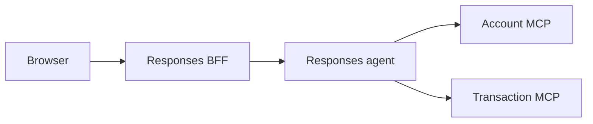

# Banking Assistant Responses Agent

This project hosts the Account and Transaction handoff workflow through the Foundry Responses protocol. It is a separate deployable from the browser-facing BFF under [`app/responses-bff`](../responses-bff).

Transaction disputes are the workflow's persisted support-case use case, not a
third specialist. The agent identifies the transaction, gathers the customer's
reason, requests explicit approval, and explains tool-reported outcomes. The
Transaction service owns policy, triage, ownership checks, and case events; the
agent never determines dispute legitimacy or invents a missing fraud score.

Existing-case consultations are read-only. Triage routes case lists, status,
timelines, and follow-ups to Transaction. Ambiguous references require customer
selection; status follow-ups refresh case details and event questions fetch the
timeline. Missing and foreign cases are described equivalently as unavailable.
Customer consent and `IN_REVIEW` do not establish operator takeover or a verdict.
Manual-created cases use the same persisted follow-up tools; creating one does not
invoke a background model.

Discovery accepts merchant, approximate date, amount and masked-card clues, with
explicit selection among at most five readable tool-backed candidates. Full verified
product numbers remain necessary where the existing lookup contract requires them;
masked digits and database IDs are not lookup keys. Latest-movement lookup covers
only five movements, and MCP tools have no date/pagination arguments. No match is
reported within that limited searched scope, not as proof of exhaustive history.
Incorrect-amount complaints preserve the expected amount in the reason under the
existing full-original-amount policy, never a promised partial refund.

## Direct MCP OAuth delegation

The optional `MCP_IDENTITY_MODE=oauth` path delegates the customer's OAuth access
token to direct Account and Transaction MCP connections using only the
`Authorization` bearer header. It does not send a custom banking identity header
to either MCP. The services validate the Identity-issued RS256 JWT against trusted
public keys, issuer, audience, expiry and `mcp.access`; existing service-level
customer ownership checks remain mandatory. This is not an Entra login migration.

Configure `MCP_IDENTITY_MODE=oauth` consistently in the BFF, agent and MCP services.
For the agent, select `AGENT_RUNTIME=local` and configure `ACCOUNT_MCP_URL` and
`TRANSACTION_MCP_URL`: `local` selects direct HTTP transport, even for a hosted
agent, and does not mean offline model execution. OAuth mode rejects the experimental
Toolbox route because per-user bearer passthrough has not been demonstrated.
Missing, expired or malformed delegated grants fail closed without HMAC fallback.
Default `MCP_IDENTITY_MODE=hmac` preserves existing behavior.

The hosted manifest fixes `AGENT_RUNTIME=foundry` and `MCP_IDENTITY_MODE=oauth`
for the approved remote Toolbox target; neither requires an azd environment variable.
Local execution remains `local`/`oauth`, connecting directly to the two MCP services.
The current adapter still rejects OAuth Toolbox consumption until supported per-user
caller/grant binding is implemented and verified. The hosted target is not runtime
readiness. Keep the BFF and both MCP services in the same identity mode.
No OAuth client secret, signing private key or JWKS is passed to the agent; those
belong to Identity, confidential clients or MCP validators.

The BFF keeps OAuth tokens server-side and includes the current grant in its signed
per-request identity envelope. That BFF-to-agent envelope remains necessary because
Foundry authentication occupies the upstream Authorization header. Tokens must not
enter model instructions, browser storage, responses or logs. Browser login and
direct financial REST authentication retain current Identity checks.

Access tokens last 3600 seconds (one hour). Authorization codes and BFF state
retain their 300-second expiry. MCP JWT validation does not perform per-call Identity
introspection, so revocation and profile changes can take up to that lifetime to
invalidate a token. `mcp.access` permits existing customer MCP reads and dispute
operations. It does not elevate roles, bypass resource ownership or replace explicit
case-creation consent. Old `banking.read` grants are rejected and require fresh consent.
See the [BFF guide](../responses-bff/README.md) for authorization-code consent and
grant custody, the [Identity guide](../business-api/identity/README.md) for signing
configuration, and [ADR 0012](../../docs/adr/0012-local-oauth-jwt-validation-for-mcp.md)
for the proposed revocation tradeoff. Offline tests verify protocol behavior, not
configured grants, hosted identity transport or end-to-end runtime acceptance.

## Remote OAuth Toolbox target and historical HMAC evidence

[azure.yaml](azure.yaml) and [toolbox.yaml](toolbox.yaml) reference `account-mcp`
and `transaction-mcp` project connections with the existing customer-tool allowlists.
Both connections must be configured as OAuth2 with `mcp.access`; references alone do
not change previously deployed no-auth connections. Verify exact callbacks, PKCE
compatibility and separate banking-user grants before activation. Azure authentication
on the agent-to-Toolbox hop is separate from downstream customer OAuth.

The following observations describe the earlier no-auth/HMAC experiment, not the
approved OAuth configuration or proof of OAuth acceptance.
`AGENT_RUNTIME=foundry` uses the project's experimental `banking-tools` Toolbox
endpoint, with separate Account and Transaction allowlists and no direct-MCP
fallback. The temporary local diagnostic route has been reverted:
`AGENT_RUNTIME=local` requires `ACCOUNT_MCP_URL` and `TRANSACTION_MCP_URL` and connects
directly to those MCP services using the existing fresh customer-scoped HMAC bearer.
Local execution still uses Foundry models and its local Azure credential selection;
it is not an offline mode. Restart the local agent to pick up the restored routing.
This change does not prove runtime readiness or authorize automatic model calls.
The hosted manifest explicitly selects `foundry` and depends on `banking-tools`.
No additional Settings field is required. Direct synthetic MCP session injection
in isolated tests remains unchanged.
OAuth2 was excluded from that historical experiment, not from the current remote
target. Static customer tokens and signer secrets in connections remain prohibited.

This routing is experimental, not a working authenticated Toolbox integration.
Azure authentication owns `Authorization` on the Toolbox hop. The adapter supplies
the banking HMAC separately as `x-banking-mcp-authorization`, but forwarding is not
verified and the existing banking MCP services accept it only in `Authorization`.
Consequently authenticated calls fail closed. Do not deploy this routing as a
functional replacement until downstream identity delivery is proven.

On 2026-10-16, live discovery against both existing MCP services failed with
`HTTP_307`: the configured `/mcp` URLs redirect to `/mcp/`, and Toolbox does not
follow that redirect. The agent azd `development` environment now uses the canonical
trailing-slash URLs. Toolbox version 2 was deployed and explicitly published as the
default after its discovery returned all 17 allowlisted tools. Read-only Account
calls through version 2, both without banking identity and with a synthetic invalid
`x-banking-mcp-authorization`, returned the missing-identity rejection. This proves
discovery and fail-closed behavior, not arbitrary-header forwarding or valid HMAC
acceptance. The published default endpoint was independently checked and also
returned 17 tools. Transaction calls returned tool errors, without establishing
their authentication cause. No model was invoked during these probes.

Later on 2026-10-16, the explicitly authorized agent-only redeployment succeeded:
`azd deploy home-banking-agent --cwd app\agent --environment development --no-prompt`
created version 28, and an independent `azd ai agent show` confirmed status `active`.
No additional MCP service was provisioned. This confirms deployment of the
experimental route, not successful authenticated tool calls or end-to-end readiness.

The subsequent local diagnostic patch was checked with 131 focused agent tests.
Account and Transaction were redeployed to their existing App Services through
`azd deploy account --environment development --no-prompt` and
`azd deploy transaction --environment development --no-prompt` from the root project.
Both deployments succeeded and both canonical `/mcp/` endpoints returned HTTP 200
for MCP initialization. Each service's three tracing tests passed. Initialization
is not a protected tool call and does not prove HMAC propagation or financial access.
No provisioning, database migration or hosted-agent redeployment was performed for
this diagnostic patch.

Microsoft's [hosted Toolbox guide](https://learn.microsoft.com/azure/foundry/agents/how-to/tools/use-toolbox-hosted-agent)
separates Azure authentication to Toolbox from the downstream credential selected
by each tool's connection. `FoundryToolbox` forwards the hosted per-request call ID;
the guide does not promise forwarding arbitrary customer HMAC headers. With
connection authentication set to `none`, the current configuration therefore has
no documented authenticated path to the banking MCP services. Fixing discovery
alone does not remove that incompatibility. Do not replace the fresh customer HMAC
with a static connection token, expose the signer, or weaken MCP authorization.
A diagnostic resource or an alternative authentication/transport strategy requires
explicit authorization before further deployment.

Run the following from the repository root only after authorizing cloud operations.
Use the existing agent azd environment, with `FOUNDRY_PROJECT_ENDPOINT`,
`AZURE_SUBSCRIPTION_ID`, `ACCOUNT_MCP_URL` and `TRANSACTION_MCP_URL` already configured.
The MCP URLs must be cloud-reachable HTTPS endpoints, not localhost. Use their
canonical `/mcp/` paths to avoid redirects. Do not dump the azd environment or place
credentials in command arguments.

```powershell
$env:AZURE_DEV_USER_AGENT = "microsoft_foundry_skill"
rtk proxy azd deploy banking-tools --cwd app\agent
rtk proxy azd ai toolbox show banking-tools --cwd app\agent
rtk proxy azd ai toolbox versions list banking-tools --cwd app\agent
```

Deployment creates an immutable version but does not automatically promote it.
Test the new version's MCP endpoint, then select it with
`azd ai toolbox publish banking-tools <version> --cwd app\agent` before testing
the unversioned consumer endpoint.

Before agent integration, test a separate diagnostic MCP with non-secret changing
headers through Toolbox. Verify delivery, cross-request isolation, session reuse
and header collisions; do not expose an echo endpoint on the banking services.
Discovery without the required identity may fail: that is not permission to disable
MCP authentication. Configuration and deployment do not prove header forwarding.

After forwarding and agent consumption are implemented and validated, provision
only if required, then deploy the agent separately:

```powershell
$env:AZURE_DEV_USER_AGENT = "microsoft_foundry_skill"
rtk proxy azd provision --cwd app\agent
rtk proxy azd deploy home-banking-agent --cwd app\agent
```

Provisioning can create or update model deployments declared in the manifest; it is
not needed merely to redeploy an already provisioned agent. Deploying the current
source activates the experimental Toolbox route. Version 28 is active with that
route; version 27 predates the routing change. The alternative
[toolbox.yaml](toolbox.yaml) requires named `account-mcp` and `transaction-mcp`
project connections created with `--auth-type none`; use either that imperative
path or the declarative service, not both for the same Toolbox.

## Grounding and confidentiality

Triage, Account and Transaction prepend the same English [guardrail policy](src/app/agents/azure_chat/guardrails.py).
They must ground answers in authenticated context and authorized tool results, treat
customer and tool-returned text as untrusted data, and refuse instruction overrides,
credential disclosure and hidden-prompt requests. Refusals follow the stored profile
locale, do not echo secrets, and do not use tools or handoffs to satisfy forbidden
requests. Security refusals, warnings and redirections use the same authenticated
profile language as normal answers, never a default English refusal for a Spanish
or Portuguese profile, even when a message requests a language override. The
per-request locale provider reinforces this rule for every agent run.
The [refusal middleware](src/app/adapters/refusal_locale_middleware.py) also replaces
SDK-marked provider refusals with controlled en/es/pt text, for streaming and final
responses, using the signed profile locale. It does not translate unmarked model
prose or tool results, and adds no telemetry flags or spans.

**Known limitation:** the owner confirmed refusal behavior in the browser, but refusal
localization still fails there and further debugging is deferred. The supplied SSE
contains an English refusal as ordinary `output_text`, not structured `refusal`
content. The middleware intentionally leaves ordinary text unchanged. This evidence
does not establish whether the provider omitted refusal metadata, a later layer lost
it, or the running deployment differs from the tested code. Browser localization and
hosted-model locale acceptance remain open; the offline middleware fix does not close
them.

[Microsoft Learn's Responses schema](https://learn.microsoft.com/rest/api/microsoft-foundry/aiproject#components)
distinguishes ordinary text from structured refusals. The reviewed documentation did
not provide a refusal-language setting or guarantee. If debugging resumes, inspect
controlled provider metadata at the
[chat-middleware boundary](https://learn.microsoft.com/en-us/agent-framework/agents/middleware)
before choosing another fix. Do not infer content filtering from refusal wording alone
or translate arbitrary agent Markdown.
Independently valid banking questions in mixed requests remain supported.
Authorized bank numbers, masked cards and existing consent transport are preserved.

This prompt policy is defense in depth, not an authorization boundary or guaranteed
model immunity. Offline tests verify policy content and actual agent configuration;
real-model refusal and hosted deployment require separate validation. Never use real
credentials in adversarial test messages.

## Pre-intake consent and localized context

Selected-charge confirmation is separate from explicit case consent. The Transaction
agent first calls `previewTransactionDispute` with the selected transaction and reason.
The preview is read-only and contains no persisted case or case ID. Explicit consent
to create the case and request review is required before `reportTransactionDispute`
accepts the signed preview token. Decline creates no case or event; unclear or unrelated
affirmation requires clarification. Acceptance records intake, consent and routing
atomically in `IN_REVIEW`, without a second review-consent step.

The shared frontend proposal displays tool-backed amount/currency, date, masked card,
merchant and optional owned country/city. Proposal tokens stay in transport, never
assistant prose. Acceptance lasts ten minutes; read-only `recoverTransactionDispute`
recovery lasts 24 hours from issuance. Ambiguous failures require recovery, not blind
resubmission, and a null recovery result remains uncertain. Successful intake responses
produce factual receipts only after confirmed persistence/readback. Sequential duplicate
intake recovers an owned active case through list/detail readback. Eligibility and
ownership remain service decisions. Existing `WAITING_USER_APPROVAL` cases retain their
legacy consent path. See the [Transaction contract](../business-api/transaction/README.md#customer-dispute-proposal-and-consent).

The authenticated [locale provider](src/app/context/user_profile_provider.py) injects the
stored en/es/pt response language once per request. Generated prose and human-readable
status labels use that language; canonical structured keys, status codes and tool names
remain unchanged. Spanish generated labels consistently use `reclamo`/`reclamos` with
masculine grammar, not `disputa` or `reclamación`. Quoted customer reasons and original
audit text remain verbatim. Agent instructions and tool descriptions remain authored
in English; frontend catalogs do not translate agent Markdown.

After REST-recorded acceptance, chat calls `getSupportCase` for the supplied case
and acknowledges confirmed readback, without recreation or second consent.

Focused localization checks, from the repository root:

```powershell
$env:OTEL_SDK_DISABLED = 'true'
rtk proxy uv run --directory app\agent python -m pytest tests\test_internal_identity.py tests\test_hosted_workflow.py tests\test_settings.py -q
```

Result: 80 passed, 24 dependency deprecation warnings. Scripted SDK continuations cover accept,
decline, unclear consent and REST-accepted readback; they prove session/tool plumbing,
not real-model judgment. The owner reported the feature working; full browser locale,
real-model consent, PostgreSQL contention and hosted acceptance remain separate gates.

Assigned-operator verdicts and recorded financial effects are implemented in the
Transaction service, not executed by this agent. An invalid verdict has no compensation;
a valid pending verdict is not a completed effect. Completion claims require returned
financial-effect status and movement evidence. Card protection requires independent
returned evidence and is application-local, not external processor enforcement.
Stored synthetic fraud scores are routing signals, not an investigation or proof.
Deterministic instruction-contract tests verify these requirements are present,
not that a real model follows them; persisted and browser validation remain separate.

## Package and responsibility seams

The installed `app` package lives under `src/app`. Authenticated context providers
live in `context`; protected SDK compatibility lives in `adapters`. Composition
roots retain deployment-keyed client reuse and independent model overrides. Sync
and async credential consumers remain supported. Logging configuration is packaged
and invalid configuration falls back once to a bounded console configuration.
Handoff buffering, output suppression and Responses streaming are unchanged.

## Runtime Flow



The browser never sends Azure credentials to Foundry. The BFF validates the application JWT and signs the verified `sub` and `customer_id` for this agent. The agent verifies that envelope and creates a fresh 60-second bearer for Account and Transaction MCP calls. In hosted mode, the BFF obtains its Azure token server-side before forwarding the request.

## Local Setup

Requirements:

- Python 3.11 or newer
- `uv`
- Azure OpenAI access configured in `.env` (copy `.env.example`)
- Account MCP on port `8070`
- Transaction MCP on port `8071`

Install dependencies and run the local Responses host:

```powershell
cd app/agent
uv sync --dev --frozen
$env:PROFILE="dev"
uv run python main.py
```

The agent listens on port `8088`. Browser traffic should go through the BFF on port
`8080`, not directly to this process. F5 runs the root `DEV - Full Stack Ordered`
launch with `noDebug: true`, ordered service tasks and no automatic browser launch.
That task loads the agent's `.env`, sets `AGENT_RUNTIME=local` and uses the root
output runner for colored severity labels and daily `logs/agent-YYYY-MM-DD.log` files.
Both `ENABLE_SENSITIVE_DATA` and `OTEL_INSTRUMENTATION_GENAI_CAPTURE_MESSAGE_CONTENT`
are explicitly `true` in the local task. Keep logs private: common credential redaction
does not remove conversation content, and no automatic retention cleanup is configured.
The manual command above does not apply those task overrides or daily output capture.
See the [root startup guide](../../README.md#run-locally).

The hosted code package contains only this project. Its manifest and lockfile must
not depend on repository-root evaluation packages or other external local paths.
The evaluation project owns the optional dependency on the agent, not the reverse.
[.agentignore](.agentignore) controls the hosted source ZIP exclusions using gitignore
syntax. It excludes local environments, secrets, caches and development-only tests
and evaluation assets, while retaining `main.py`, `src/`, `pyproject.toml`, `uv.lock`, `README.md`
and runtime logging YAML. This is the hosted-agent packaging ignore file, not
`.azdignore`. Exclusions do not install the `app` package or establish hosted readiness.
Run the complete agent suite, including evaluation integration tests, from the
repository root using the combined evaluation environment:

```powershell
rtk proxy uv sync --project evals --extra offline --extra model --frozen
$env:OTEL_SDK_DISABLED = "true"
rtk proxy uv run --project evals --frozen --no-sync python -m pytest app\agent\tests -q
```

Hosted-agent CI also restores an isolated copy of this project's dependencies on
Python 3.13, without the repository-root evaluation directory, before running tests.
This check verifies packaging isolation, not hosted activation or model behavior.

## Configuration

This directory is a separate `azd` project root because it has its own `azure.yaml` at `app/agent/azure.yaml`. The repository root `azure.yaml` (App Service stack) and this agent `azure.yaml` (hosted agent stack) do not share `azd` environment state automatically.

When you run commands with `--cwd app/agent` (or directly from this folder), `azd` may prompt for:

- An agent environment name
- Azure subscription
- Azure region/location

Using the same environment name as root is fine for consistency, but state is still independent per project root.

Configure the Foundry project endpoint and the name of a model deployment in that project:

```env
FOUNDRY_PROJECT_ENDPOINT=https://your-resource.services.ai.azure.com/api/projects/your-project
AZURE_AI_PROJECT_ID=/subscriptions/<subscription-id>/resourceGroups/<resource-group>/providers/Microsoft.CognitiveServices/accounts/<account-name>/projects/<project-name>
MODEL_DEPLOYMENT_NAME=gpt-5.4
ACCOUNT_MCP_URL=http://localhost:8070/mcp
TRANSACTION_MCP_URL=http://localhost:8071/mcp
INTERNAL_IDENTITY_SECRET=<shared-secret-at-least-32-characters>
```

For hosted provisioning with `azd`, make sure the agent environment includes at least:

- `FOUNDRY_PROJECT_ENDPOINT`
- `AZURE_AI_PROJECT_ID`
- `MODEL_DEPLOYMENT_NAME`
- `ACCOUNT_MCP_URL`
- `TRANSACTION_MCP_URL`
- `INTERNAL_IDENTITY_SECRET`: the existing BFF transport signer, at least 32 characters.

Local tasks load the agent's own `.env` and use Azure CLI credentials when
`AGENT_RUNTIME=local`; hosted `foundry` runtime uses managed identity, with optional
`AZURE_CLIENT_ID` for a user-assigned identity. The credential-free
[template](.env.example) selects local direct MCP and `MCP_IDENTITY_MODE=oauth`;
keep that identity mode consistent with the BFF and both MCP services. Supply
`MCP_IDENTITY_MODE` in the process environment through the root tasks or
`uv --env-file`, because the MCP identity helper reads it from the environment,
not from the `Settings` object. The BFF transport signer is required in either mode.
OAuth client secrets and grants do not belong in this template.

Keep MCP URLs, Foundry settings and the shared transport identity secret in the
agent's local configuration. The template leaves the optional Application Insights
connection string unset. `ENABLE_OTEL` currently has no consumer in the Responses
entrypoint, so it is not a supported telemetry on/off switch.

Hosted deployment is owned by the [agent manifest](azure.yaml) and uses managed identity. Its `ai-project` service declares `model-router` and `gpt-5.4` deployments for provisioning; the hosted agent references that project. The manifest explicitly maps `FOUNDRY_PROJECT_ENDPOINT` and `INTERNAL_IDENTITY_SECRET` from the selected agent azd environment into the container. The signer must match the existing BFF signer; the agent environment does not inherit the BFF's local dotenv settings. An empty signer prevents startup through `Settings` validation and can surface as HTTP 424 / `session_not_ready`. Synchronize the existing value only with explicit authorization; never print it, rotate it as a workaround, or weaken validation. `AUTH_INTERNAL_SECRET` is a separate Identity introspection secret. Shared and per-agent environment settings select runtime deployments; manifest declarations and local tests do not verify available capacity or hosted end-to-end behavior.

### Hosted source dependency installation

The source deployment explicitly uses `dependencyResolution: remote_build`. Keep
[requirements.txt](requirements.txt) synchronized with [uv.lock](uv.lock):

```powershell
rtk proxy uv export --project app\agent --frozen --no-dev --no-editable --no-hashes --no-header --output-file app\agent\requirements.txt
```

Run this command from the repository root. The deliberate `.` entry installs the
local distribution noneditably, including `src/app` and its logging configuration.
Do not add `--no-emit-project`: dependencies alone do not make this src-layout
package importable. The source ZIP must retain `main.py`, `src/`, `pyproject.toml`,
`README.md` and `requirements.txt`; moving the entrypoint alone does not install
`app`. A reference project with a package at its root can import it without this
installation, so that layout is not evidence of src-layout support.

Hosted-agent CI checks the frozen export and installs the requirements into an
isolated Python 3.13 environment. CD rejects a stale requirements artifact before
deployment. These checks do not establish that the remote builder successfully
installs the application: verify hosted build logs and `/readiness` returning HTTP
200 after deployment before claiming the HTTP 424 startup failure is resolved.

### Optional per-agent model deployments

Each agent can use a distinct deployment in the same Foundry project. Unset or
empty overrides use the configured `MODEL_DEPLOYMENT_NAME` shared fallback.
The shared setting is required only for agents without a nonempty override; it
can be unset when all three overrides are configured. There is no automatic
runtime deployment default:

```env
TRIAGE_MODEL_DEPLOYMENT_NAME=model-router
ACCOUNT_MODEL_DEPLOYMENT_NAME=gpt-5.4
TRANSACTION_MODEL_DEPLOYMENT_NAME=gpt-5.4
```

These values are deployment names, not automatic model provisioning. The Responses
host creates one client per distinct effective deployment, reusing it when names
match. Direct workflow callers can also pass `account_chat_client` and
`transaction_chat_client`; omitted clients reuse the triage client. Identity,
locale, tools, and the Account/Transaction handoff topology remain unchanged.

Microsoft Learn documents [model-router agentic tool support](https://learn.microsoft.com/en-us/azure/foundry/openai/concepts/model-router)
and [Foundry Responses inference through a router deployment](https://learn.microsoft.com/en-us/azure/foundry/openai/how-to/model-router#test-model-router-with-foundry-responses-and-chat-completions).
The [GPT-5.4 catalog](https://learn.microsoft.com/en-us/azure/foundry/foundry-models/concepts/models-sold-directly-by-azure#gpt-54)
lists Responses, Chat Completions, and function/tool calling support. Router model
eligibility and deployment availability depend on region, access, and deployment
configuration. Configure an eligible tool-capable routing pool; no project
availability or live end-to-end compatibility is established by offline tests.
The [hosted manifest](azure.yaml) forwards the shared setting and all three optional
overrides; configure them in the agent azd environment to select the deployed host's
models.

## Validation

```powershell
uv run python -m pytest tests/test_hosted_workflow.py tests/test_internal_identity.py tests/test_settings.py tests/test_model_configuration.py tests/test_mcp_replay.py -q
```

The focused suite passed with 23 tests covering handoff completion, safe ownership
denials, signed identity, settings, and concurrent workflow-request isolation. SDK
deprecation warnings and a telemetry-exporter connection failure remain separate from
the passing test assertions.

On 2026-09-30, the user confirmed local browser success through the BFF: an owned
account returned details and masked cards; a foreign account reached
`getAccountDetails(product_number=...)`, returned `ACCESS_DENIED`, and produced a
visible assistant denial before `response.completed`. No foreign financial data was
returned. Missing/empty account cases, multi-turn checkpoint restoration, approval
continuation, and hosted identity transport remain unverified end to end.

### Dispute Evaluation Coverage

The [evaluation guide](../../evals/README.md) separates evidence levels:

- [Service regression tests](../business-api/transaction/tests/test_dispute_service.py)
  exercise seeded business rules, ownership, case events, and recommendations.
  They do not evaluate the model.
- [Isolated replay](../../evals/run_mcp_replay.py) injects Account and Transaction
  SDK memory sessions into the existing workflow. A model run uses a real Foundry
  model and synthetic signed identity, without the BFF, database, real business
  APIs, or application JWT. Production HTTP/authentication defaults stay intact.
- [Dispute replay v2](../../evals/dispute_cases.json) contains 25 development-exposed
  synthetic confirmation cases with frozen expanded inputs. Approval leaves every
  score band IN_REVIEW; score routes review, not legitimacy or financial effects.
- [Historical scenarios](../../evals/scenarios.json) preserve 18 obsolete-policy
  diagnostics. Their label-derived baseline and keyword classifier are not current
  acceptance or untouched held-out evidence.

The isolated MCP replay's three cases cover balance lookup, canned denial, and empty
transactions, not disputes. [CI run 37264970360](https://github.com/cristofima/factored-hackathon-2026-cristopher-coronado/actions/runs/37264970360)
passed agent build/tests, real-model MCP protocol smoke and offline Dispute Replay
alignment, comparator and saved-evidence rescoring checks at commit
`ee40605859f3ae7c2e047182025c8c304bead418`, with evidence uploads and PR reporting.
Offline dispute checks are not real-model dispute evaluation. `protocol_passed`
checks calls and completion, not grounding, locale, approval correctness or dispute
success; live authorization, persisted effects and hosted end-to-end acceptance
remain separate gates. See the [replay guide](../../evals/README.md#pr-smoke-check).

Session checkpoints recorded 25 offline alignment tests, synthetic comparator and
saved-evidence rescore results of 25/25 each, then 57 combined offline replay tests.
Complete redacted per-turn evidence, controlled failures and fingerprint-checked
pairing are implemented; these results predate subsequent contract changes and are
not a current rerun or a paired real-model comparison. Consultation/session checks
recorded 16 agent workflow, 23 BFF Responses, and 43 Transaction service tests passing.
Instruction assertions and mocked Identity/upstream or SQLite checks do not establish
model compliance, locale quality, live authorization, or PostgreSQL parity.
Exact historical commands and limitations are in the evaluation guide.

Next coverage must prioritize dispute identification, clarification, approval and
decline across turns, low/high/missing-score tool outcomes, safe refusals, and
status explanations grounded in returned cases/timelines. Simulated MCP replies
prove agent behavior only; real authorization and persistence require independent
service/integration checks. Generic MCP consent is not the business approval gate.

Replay reports use `home-banking-agent-mcp-replay-eval` and
`home-banking-agent-mcp-replay-eval run` as display names. Reports are currently
local/CI artifacts and `foundry_submission: not_submitted`; they do not create remote runs.
The azd-native hosted evaluation path cannot supply the required signed banking
identity header, even for prompts that need no tools. The separately authorized
historical hosted diagnostic can send that header; this is not native evaluation
or evidence of a successful hosted run. Hosted deployment success does not close
that gate.

## Hosted banking identity transport

The BFF sends a stable non-PII identifier in Foundry's reserved
`x-ms-user-identity` header and the signed banking envelope separately in
`x-client-banking-identity`. Foundry forwards `x-client-*` headers to the container
([contract](https://learn.microsoft.com/azure/foundry/agents/concepts/hosted-agent-contract#forward-custom-request-headers-to-your-container)).
The hosted entrypoint installs pure-ASGI request middleware so signature validation,
locale and grant lookup use that envelope throughout streaming and concurrent
requests, without overwriting platform user IDs, call IDs or history partitions.
Missing, duplicate or invalid envelopes fail closed. Local transport still reads
the signed `x-agent-user-id` through the SDK's request context.

Deploy the BFF and agent changes together. Delegated opaque identity additionally
requires the caller to hold Foundry's
[`UserIdentityImpersonation` data action](https://learn.microsoft.com/azure/foundry/agents/how-to/isolate-sessions-per-user#isolate-sessions-for-your-own-users)
through an explicitly assigned custom role; built-in roles do not grant it.
Format compatibility does not establish that permission. The native OAuth Toolbox adapter remains gated:
header forwarding alone is not proof of customer/native-caller/grant binding or
two-user isolation. Do not capture these headers in logs or telemetry.

## Conversation State

The browser-facing BFF uses `previous_response_id` for both local and hosted
Responses turns. It exposes only a signed customer/endpoint-bound continuation
token to the browser, then verifies and translates that token on the next request.
See the [BFF continuity contract](../responses-bff/README.md) for completion,
cancellation and temporary versus saved case-history limits. This follows the
[Microsoft multi-turn guidance](https://learn.microsoft.com/azure/foundry/how-to/develop/framework-hosted-agents#multi-turn-conversations);
offline checkpoint tests do not establish live hosted acceptance.

[The entrypoint](main.py) passes a zero-argument factory to the native
`ResponsesHostServer`. It builds a fresh workflow for each request while reusing
clients by deployment. The runtime restores the matching checkpoint before
new input; requests never share mutable graphs or executors.
[Native-host tests](tests/test_hosted_workflow.py) execute factory-produced workflows
under interleaved success, error and cancellation paths. The pinned hosting beta
still deprecates `WorkflowAgent` hosting; its supported fresh-factory path preserves
our checkpoint/context semantics without migrating to a different workflow API.

The entrypoint explicitly retains a 100-item transport history limit because
Responses 2.3.0 otherwise defaults to unlimited history. Workflow continuation uses
checkpoints, not that transport history; fresh input and immutable intake snapshots
are not truncated by this limit. [History tests](tests/test_responses_history.py)
cover the 99/100/101 boundaries and prefetched history IDs.

[Telemetry startup](src/app/telemetry.py) selects `AGENTSERVER_FLUSH_MODE=async`
before host construction. Export runs off the event loop but remains awaited;
cancellation/shutdown must not abandon an active flush.
[Mocked lifecycle tests](tests/test_telemetry_lifecycle.py) cover success, failures,
cancellation and shutdown admission without network exporters. This is telemetry
lifecycle protection, not durable business execution. Windows offline tests and
noneditable Python 3.13 installation do not prove Linux or hosted readiness.

[The checkpoint-aware handoff builder](src/app/adapters/checkpointed_handoff.py)
also synchronizes each fresh restored turn to the specialists before routing.
The installed orchestration SDK otherwise broadcasts only the initial input,
allowing a specialist's stale final answer to terminate a follow-up without an
answer. The adapter preserves normal completion, function approvals and
`request_info` continuations. It uses a narrow protected builder hook; revalidate
it when upgrading the SDK and remove it when upstream fixes fresh-turn broadcast.
[Actual-host regression tests](tests/test_responses_handoff_checkpoints.py) cover
both conversation-ID and previous-response-ID restoration, repeated turns,
cross-specialist routing, exactly-once input delivery and separate response chains.
These deterministic tests do not establish hosted or real-model acceptance.

The default checkpoint provider uses `FoundryStateStore`. Outside Foundry hosting,
the installed SDK writes JSON files under `~/.agentserver/state_stores`, or under
`AGENTSERVER_STATE_ROOT/state_stores` when configured. Execution state is in RAM,
but checkpoints can survive process restarts. They are not stored in PostgreSQL.
Treat these files as sensitive conversation data; a browser reload neither deletes
them nor resumes them automatically.

Completed-response continuation and workflow checkpoints are not failed-turn retry
or exactly-once guarantees. The current browser locks an uncertain failed,
incomplete or disconnected thread to prevent blind mutation replay. Resilient
background execution, correlated operation recovery and safe chatbot retry are not
implemented. PostgreSQL case snapshots contain only submitted visible intake
messages; they cannot restore provider execution state or a complete chat archive.
